<WritingBlock id="58321" variant="document"># PhantomLink V5 — Advanced Interactive Scam Investigator

An interactive cybersecurity investigation platform designed to analyze suspicious URLs, identify observable risk indicators, and explain investigation findings through an immersive visual interface.
Overview
PhantomLink combines secure URL validation, heuristic risk analysis, DNS intelligence, and evidence traceability to help users investigate potentially suspicious links.

Rather than providing only a safe-or-dangerous result, it explains observable indicators, supporting evidence, and analysis limitations.

Disclaimer: PhantomLink is an educational cybersecurity portfolio project. Its heuristic findings are not definitive phishing verdicts.
Key Features
- URL Investigation and Risk Assessment
- Secure URL Validation and SSRF Protection
- DNS Intelligence
- Evidence Traceability
- Interactive URL Evidence Highlighter
- Session-Based Investigation Archive
- Investigation Analytics Dashboard
- JSON and PDF Report Export
- Digital Underworld Interactive Interface
Tech Stack
Layer	Technologies
Frontend	React, Vite, JavaScript, CSS
Backend	Python, FastAPI
Database	SQLite
Testing	Pytest, Vitest, Playwright
Security	URL Validation, SSRF Protections, Session Isolation

Project Structure
- backend/ — FastAPI application, detection engine, datasets, and automated tests.
- frontend/ — React application, UI components, and end-to-end tests.
- README.md — Main project documentation.
Investigation Workflow
1. Submit a URL for investigation.
2. Validate the input against security restrictions.
3. Identify structural and heuristic indicators.
4. Generate explainable risk assessment results.
5. Explore supporting evidence and DNS information.
6. Review findings and export investigation reports.
Security Considerations
PhantomLink applies defensive input validation, private-network restrictions, and session-based investigation isolation.

The results should be interpreted as supporting evidence, not conclusive security judgments.
Development Status
Local cybersecurity portfolio prototype.
Author
Developed as a full-stack cybersecurity engineering portfolio project.</WritingBlock>

<!-- PHANTOMLINK GALLERY START -->

## Application Screenshots

### Digital Underworld
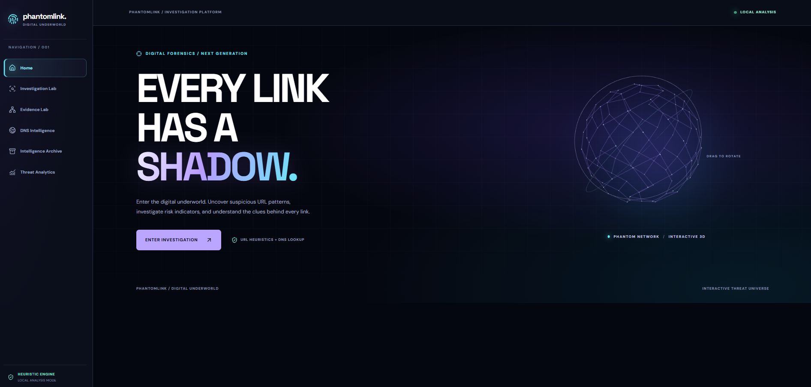

The interactive landing page introduces PhantomLink through an immersive, cybersecurity-inspired visual experience.

### Investigation Lab
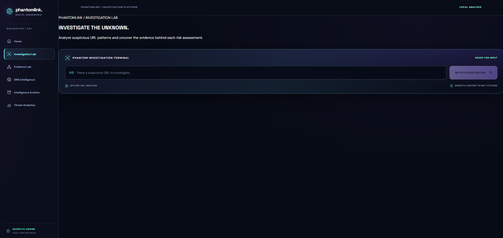

The main investigation workspace allows users to submit URLs, review risk assessments, and explore explainable security findings.

### Evidence Intelligence
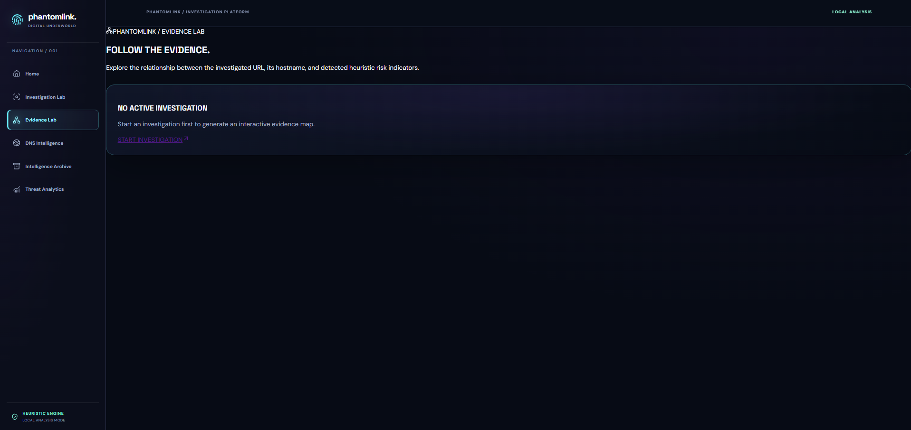

This page presents investigation evidence, supporting indicators, and detailed analysis to help users understand observed URL characteristics.

### DNS Intelligence
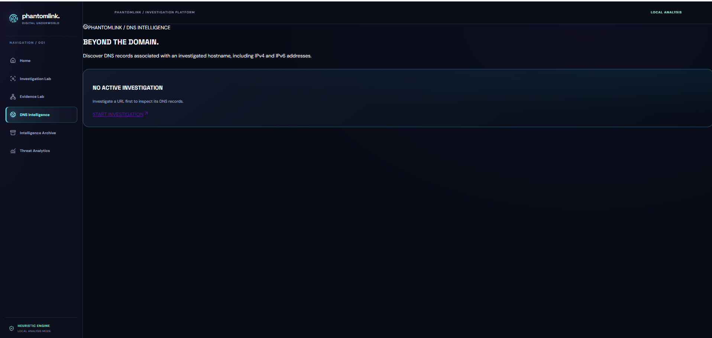

Displays DNS-related information and investigation insights to provide additional context about analyzed domains.

### Investigation Archive
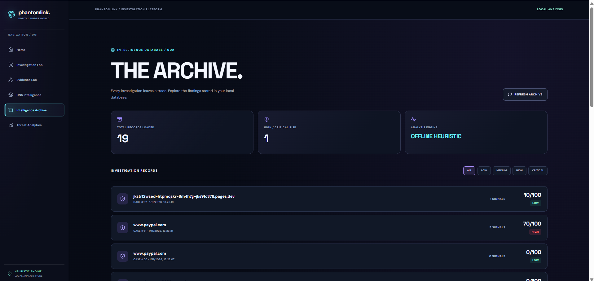

Provides access to historical investigation records with session-based separation of user data.

### Analytics Dashboard
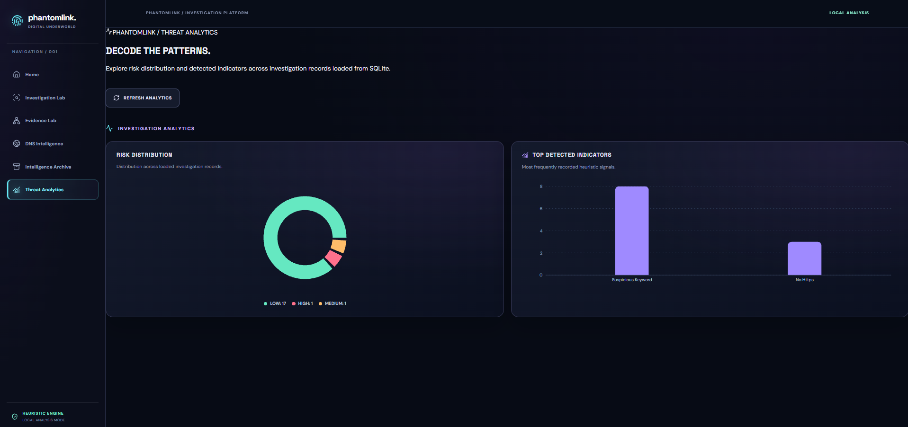

Visualizes investigation statistics and risk-related summaries through an interactive analytics interface.

## Risk Classification Testing

The screenshots below show actual outputs from local URL
investigations. These classifications are heuristic results,
not verified phishing verdicts.

### LOW RISK

Demonstrates a URL investigation with few or no suspicious heuristic indicators. A LOW RISK result does not guarantee website safety.

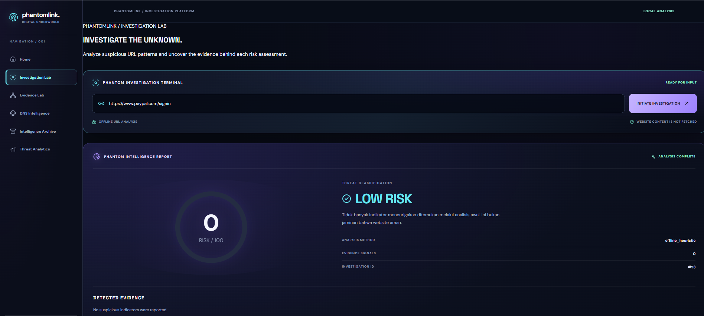

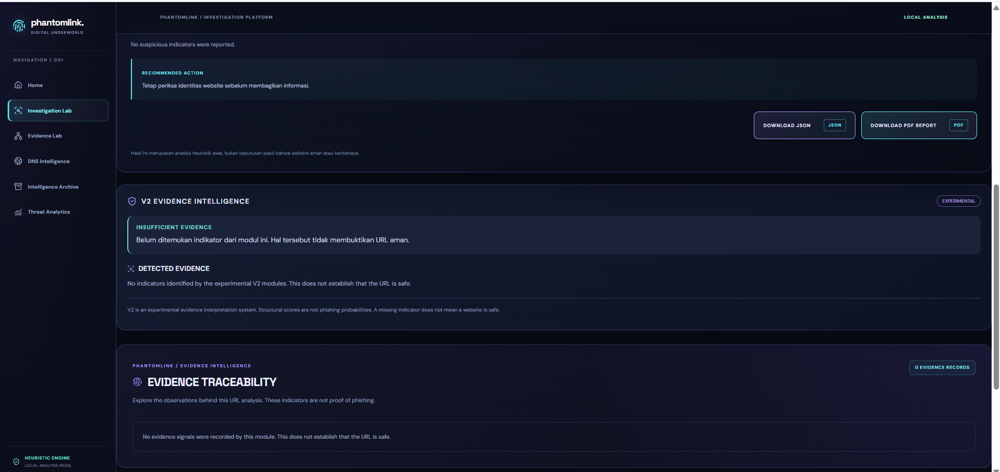

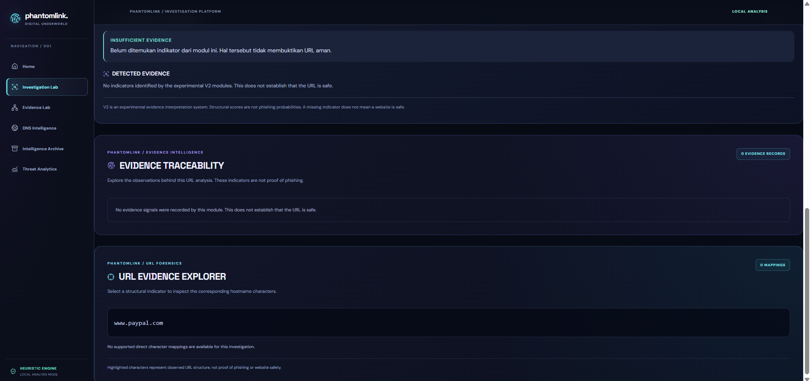

### MEDIUM RISK

Demonstrates an investigation where multiple observable risk indicators warrant further review. The classification is based on heuristic rules.

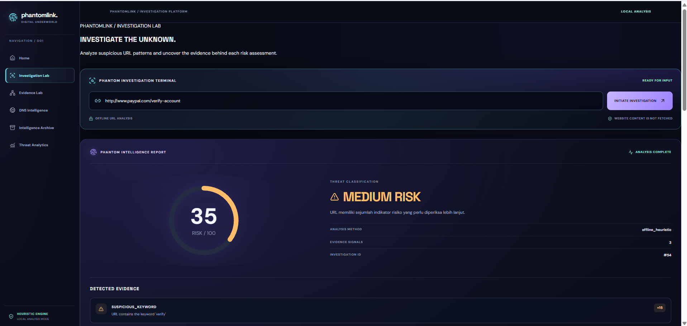

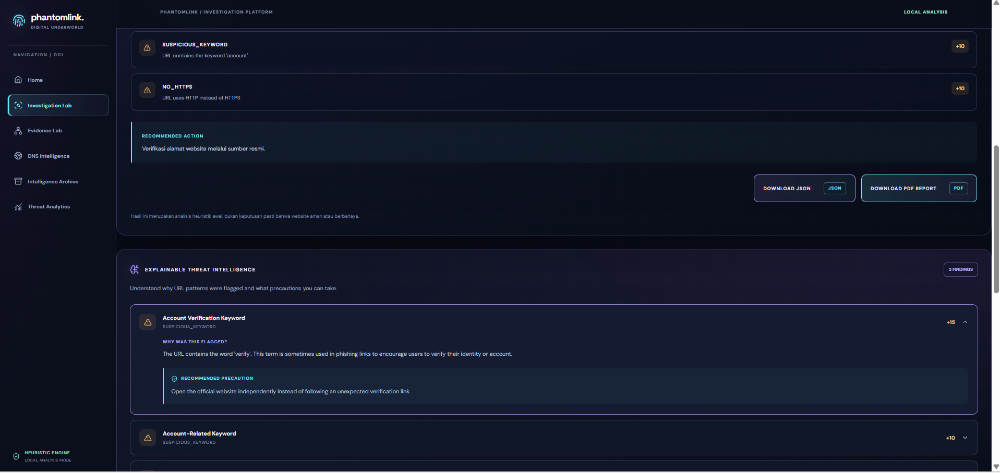

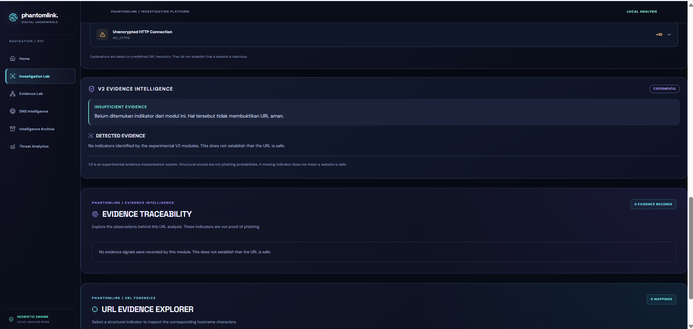

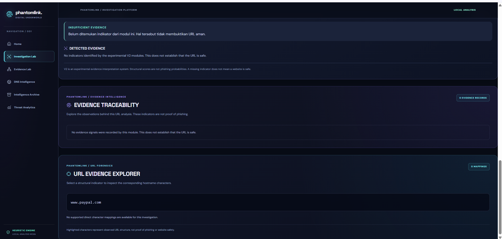

### HIGH RISK

Demonstrates an investigation with stronger or accumulated heuristic indicators. This classification does not independently confirm phishing.

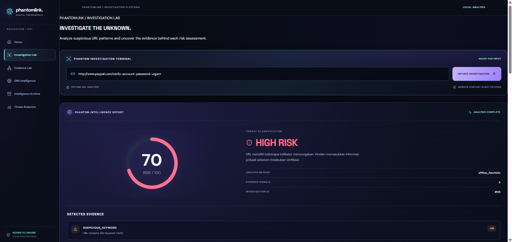

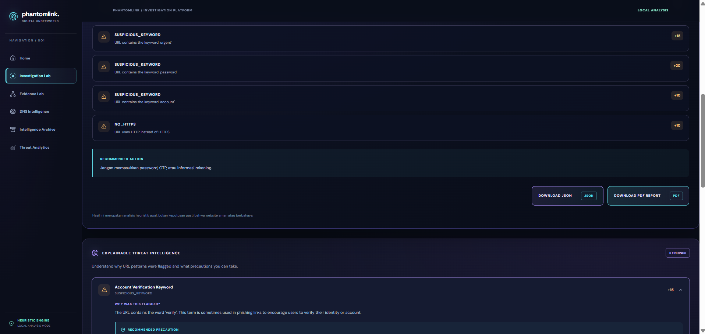

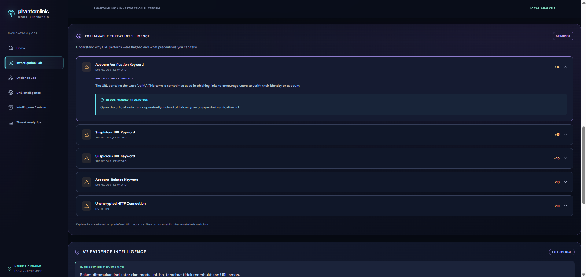

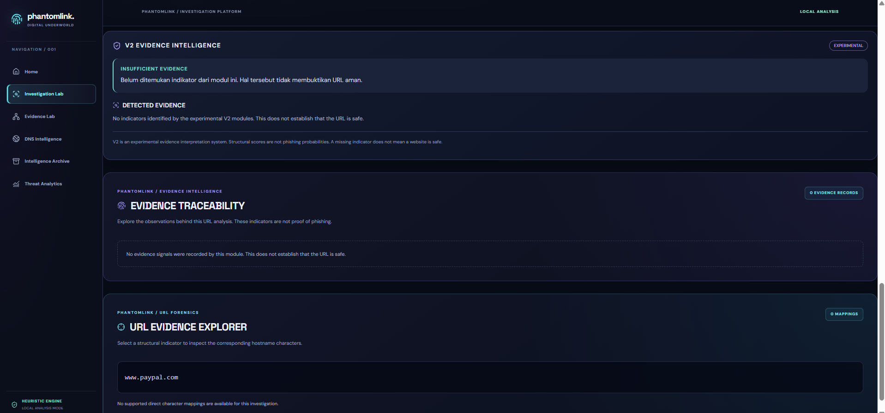

## Testing and Evaluation

- Backend: **242 Pytest tests passed**.
- Security test file: **20 tests passed** (included in the 242).
- Real URL evaluation: 100 samples (50 phishing-labeled URLs and 50 legitimate candidates), all classified LOW RISK.
- Among them, 10 phishing-labeled dataset samples were classified LOW RISK.
- These findings highlight the limitations of the V1 heuristic engine.

[Full real URL evaluation](docs/testing/real_url_evaluation.md)

<!-- PHANTOMLINK GALLERY END -->

## Testing & Evaluation

| Test Category | Dataset / Method | Total | LOW | MEDIUM | HIGH | Errors | Report |
|---|---|---:|---:|---:|---:|---:|---|
| Real URL Evaluation | 50 OpenPhish + 50 Tranco | 100 | 100 | 0 | 0 | 0 | [Report](docs/testing/real_url_evaluation_100.md) |
| Medium Risk Demonstration | Synthetic URL Patterns | 68 | 0 | 68 | 0 | 0 | [CSV](docs/testing/medium_risk_68_scenarios.csv) |
| High Risk Demonstration | Synthetic URL Patterns | 87 | 0 | 0 | 87 | 0 | [CSV](docs/testing/high_risk_87_scenarios.csv) |

**Note:** Real dataset evaluation and synthetic classification demonstrations are separate tests. The 50 phishing-labeled samples were all classified LOW RISK. Synthetic scenarios are not evidence of phishing detection accuracy.

